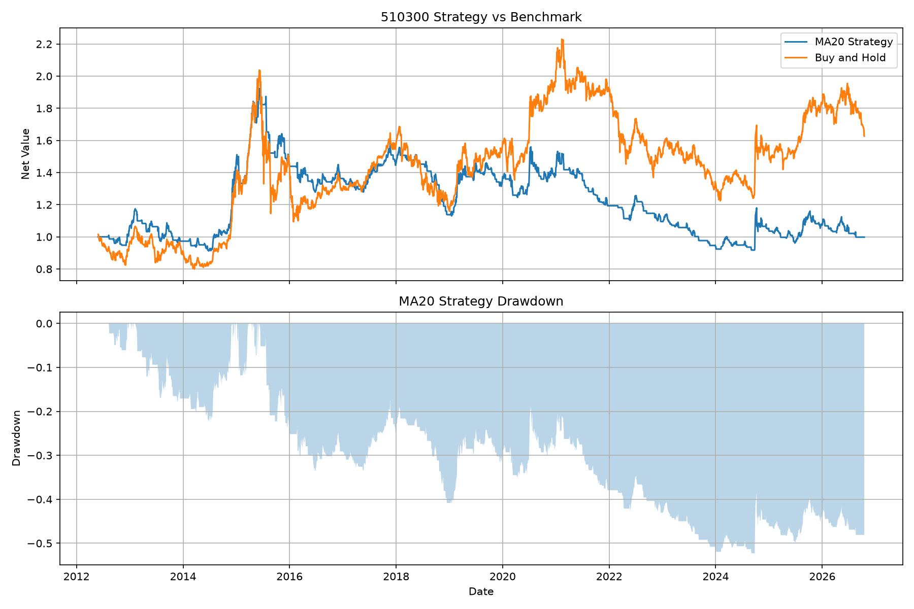
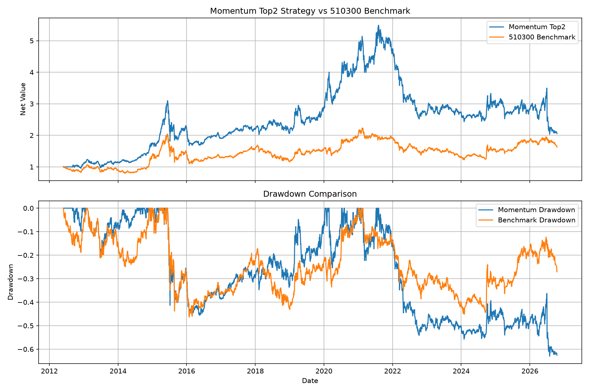

# AI辅助ETF策略与风险控制系统

基于中国市场ETF历史行情的模拟研究项目，结合规则策略、动量轮动、波动率风险控制和轻量机器学习模型，比较不同方法的收益与风险表现。

> 本项目仅用于课程、比赛和个人研究，不构成投资建议，不使用真实资金，也不产生真实交易指令。

## 项目目标

研究以下问题：

1. ETF历史行情能否支持可复现的策略研究？
2. 简单均线和动量策略的收益、风险和交易成本表现如何？
3. 波动率过滤能否改善动量策略的风险收益平衡？
4. 轻量机器学习模型是否能在样本外预测ETF未来走势？

## ETF池

项目使用8只ETF：沪深300、中证500、中证1000、证券、医药、新能源车、半导体和纳指ETF。

配置文件位于：

```text
config/etf_config.csv
```

## 策略设计

### 规则策略

- MA20趋势策略：收盘价高于20日均线时持有；
- MA60趋势策略：收盘价高于60日均线时持有；
- 60日动量Top2策略：每月选择过去60个交易日动量排名前2的ETF，等权配置；
- 动量+波动率过滤：当过去20日年化波动率超过30%时暂时空仓。

### 机器学习策略

使用逻辑回归预测510300未来5个交易日是否上涨。特征包括：

- 5日动量；
- 20日动量；
- 当前价格与20日均线的距离；
- 20日历史波动率。

机器学习模型与规则策略严格区分，不能将普通均线策略称为AI策略。

## 回测规范

- 所有信号至少延迟一个交易日执行；
- 特征只使用当期及过去信息；
- 不随机打乱时间序列；
- 训练集、验证集和测试集按时间顺序划分；
- 单次调仓手续费和滑点合计假设为0.10%；
- 评价指标包括累计收益率、年化收益率、年化波动率、最大回撤、夏普比率、卡玛比率、胜率和换手情况。

## 主要研究结果

在当前样本区间和成本假设下：

- MA20策略交易频繁，交易成本明显侵蚀收益；
- MA60策略换手较低，风险收益表现优于MA20；
- 60日动量Top2策略提高了历史收益，但最大回撤较大；
- 动量+波动率过滤降低了波动率和最大回撤，并提高了夏普比率；
- 逻辑回归模型在测试集上没有跑赢基准，但回撤和换手相对较低。

## 项目结构

```text
data/raw/                 原始ETF数据
data/processed/           清洗数据和回测结果
config/                   ETF池配置
scripts/                  数据处理、回测和模型脚本
reports/figures/          净值和回撤图表
app/streamlit_app.py      Streamlit网页看板
```

## 运行看板

安装依赖后，在项目根目录运行：

```powershell
streamlit run app/streamlit_app.py
```

然后打开：

```text
http://localhost:8501
```

## 复现流程

首次运行时，建议按照以下顺序执行脚本：

```text
1. scripts/download_all_etfs.py
2. scripts/clean_etf_data.py
3. scripts/calculate_momentum.py
4. scripts/create_momentum_signal.py
5. scripts/backtest_momentum.py
6. scripts/backtest_momentum_vol_filter.py
7. scripts/create_ml_features.py
8. scripts/train_logistic_model.py
9. scripts/backtest_logistic_strategy.py
```

原始行情和中间计算结果被`.gitignore`排除，以避免仓库过大。运行上述脚本后，数据会重新生成到`data/`目录，随后即可启动Streamlit看板。

## 可视化结果

### MA20均线策略与基准



### 60日动量Top2策略与基准



图表展示策略净值、历史回撤以及相对于510300基准的表现差异。

## 数据来源

历史行情数据通过AkShare获取。原始数据、清洗数据和回测结果均保存在项目目录中，便于复现和检查。

## 局限性

- 历史回测不代表未来表现；
- ETF上市时间不同，样本区间并不完全一致；
- 交易成本、滑点和流动性使用简化假设；
- 机器学习模型特征较少，预测能力有限；
- 项目结果不构成任何投资建议。
